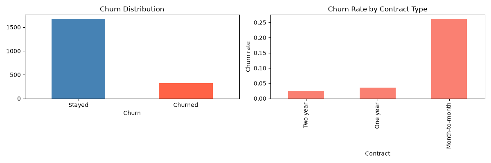
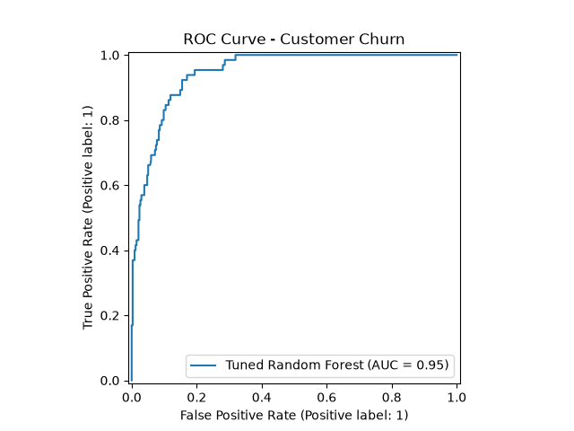
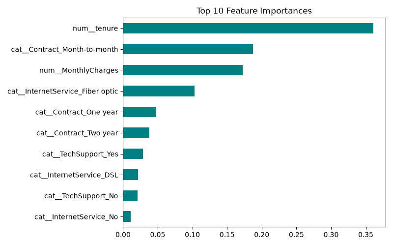

# 📉 Customer Churn Prediction & Analytics

[](https://www.python.org/)
[](https://scikit-learn.org/)
[](LICENSE)

Predict which customers are likely to leave (churn) using demographic, account and service data.
Complete pipeline: EDA → preprocessing → model comparison → hyperparameter tuning → evaluation.

## 🚀 Quick Start

```bash
pip install -r requirements.txt
python churn_prediction.py
```
Plots are saved into `images/` automatically. Runs out of the box with realistic synthetic
data — to use the real Kaggle *Telco Customer Churn* dataset instead, uncomment the
**Option B** block in `churn_prediction.py`.

## 🛠️ Pipeline
1. **EDA** — churn distribution, churn rate by contract type
2. **Preprocessing** — `StandardScaler` (numeric) + `OneHotEncoder` (categorical) via `ColumnTransformer`
3. **Models** — Logistic Regression · Decision Tree · Random Forest
4. **Tuning** — `GridSearchCV` (n_estimators × max_depth) + 5-fold cross-validation
5. **Evaluation** — Precision, Recall, F1, ROC-AUC, confusion matrix, ROC curve

## 📊 Results (synthetic data)
| Model | ROC-AUC | CV ROC-AUC |
|---|---|---|
| Logistic Regression | 0.954 | 0.972 |
| Random Forest (tuned) | 0.946 | 0.959 |
| Decision Tree | 0.780 | 0.832 |

## 🖼️ Plots




## 🔗 Dataset (real)
Kaggle → *Telco Customer Churn* (`WA_Fn-UseC_-Telco-Customer-Churn.csv`)

## 📄 License
MIT — see [LICENSE](LICENSE). Part of my [ML portfolio](https://github.com/rajwardeep7-wq).
